# TP4 — Limiter les données DynamoDB avec IAM FGAC

Nova Services · Gouvernance des identités et des habilitations · Mohammad Jabbari · 26 novembre 2026.

**COMPLETE — nettoyage AWS exécuté et vérifié.** Les 23 scénarios DynamoDB antérieurs au nettoyage sont conformes : 6 PASS et 17 EXPECTED DENY. Les seules ressources TP4 ont été supprimées ; aucun push GitHub effectué. La limite d'audit GetLoginProfile est conservée séparément au statut PARTIAL : une SCP refuse cette lecture au rôle administrateur.

Le lecteur peut maintenant lire uniquement `id`, `username`, `email` du dossier `001` avec GetItem ou Query. Le dossier `002`, les attributs `ssn` et `internal_note`, les lectures sans projection, Scan et les écritures sont refusés. La policy finale est l'unique inline `TP2AFGAC`, version LeadingKeys.

## Résultats et livrables

- [Rapport final](docs/rapport-final.md) et [rapport pré-nettoyage historique](docs/rapport-pre-cleanup.md).
- [Matrice détaillée : attendu, observé, code réel et preuve](docs/tests.md).
- [Compte-rendu en 19 sections](compte-rendu.md), [huit réponses](docs/questions.md), [architecture](docs/architecture.md).
- [Treize captures réelles et journaux expurgés](preuves/README.md), incluant la capture de clôture.
- [Sujet officiel, empreinte et conformité](docs/sources/README.md).

## Galerie des preuves AWS

Les captures ci-dessous sont les preuves réelles expurgées, conservées dans `preuves/`.

| Captures réelles | | |
| --- | --- | --- |
| 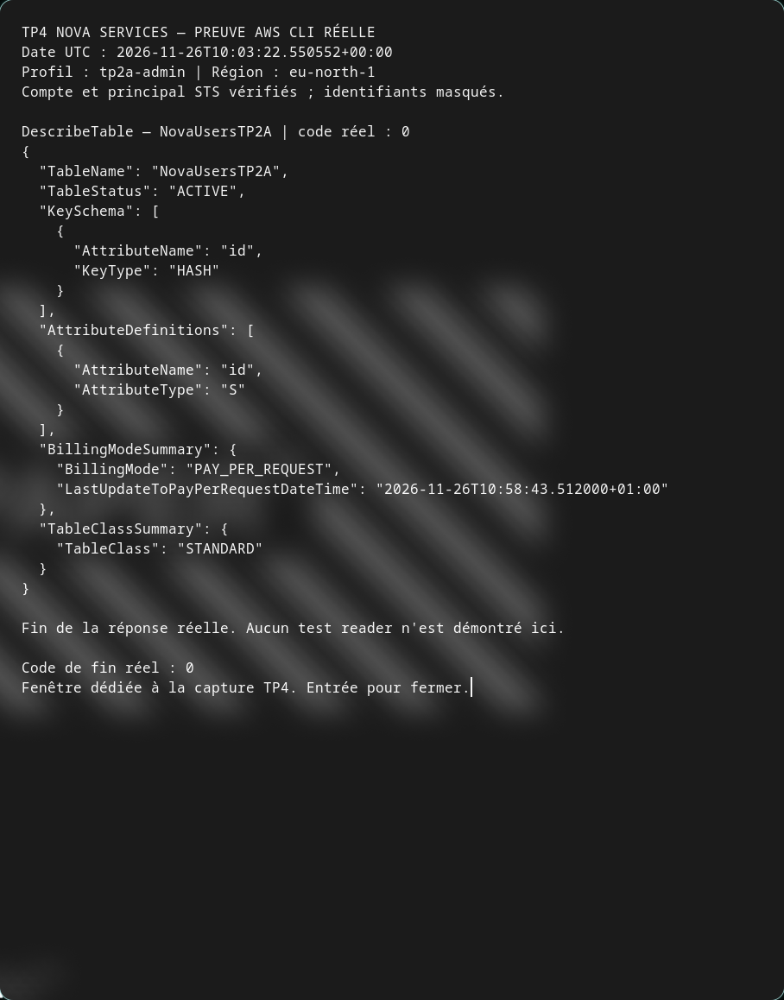 | 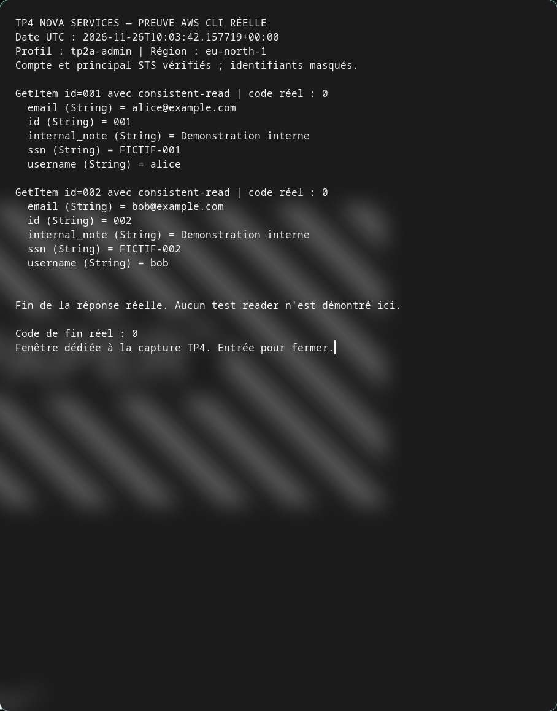 | 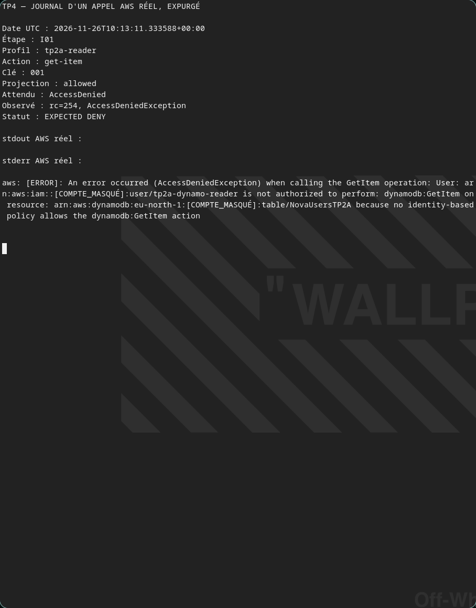 |
|  | 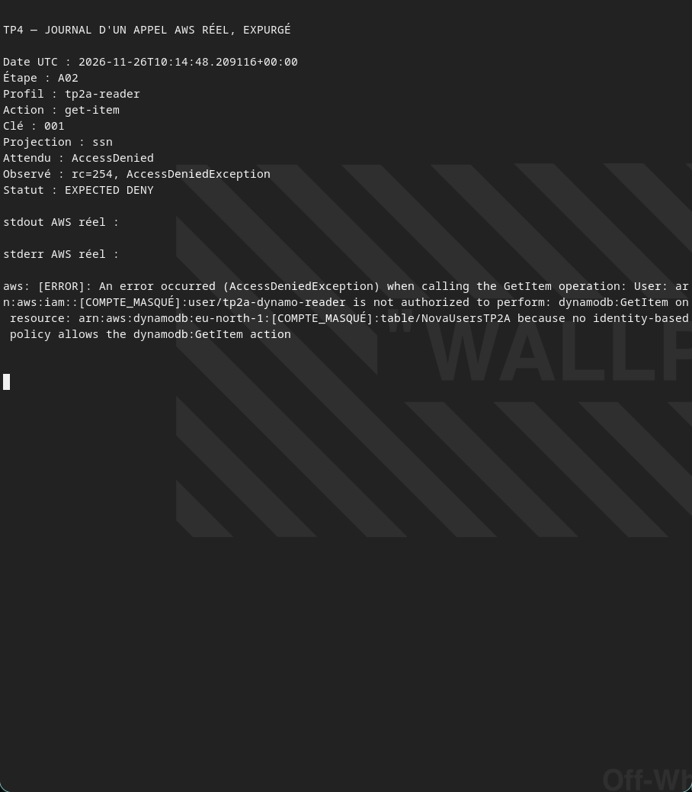 | 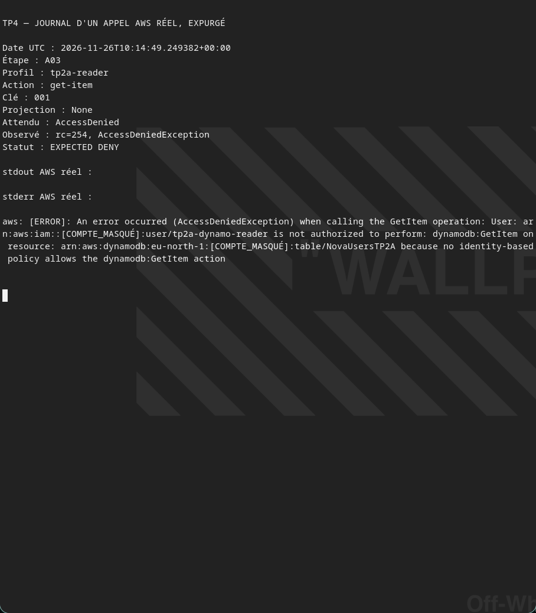 |
| 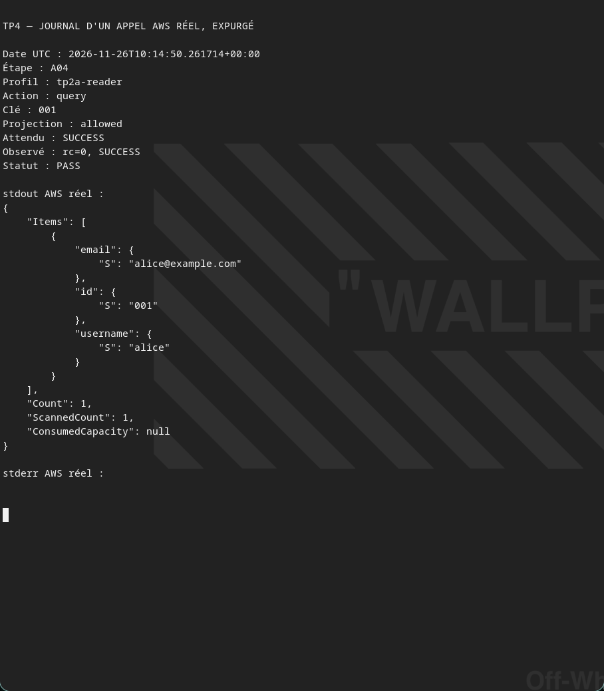 | 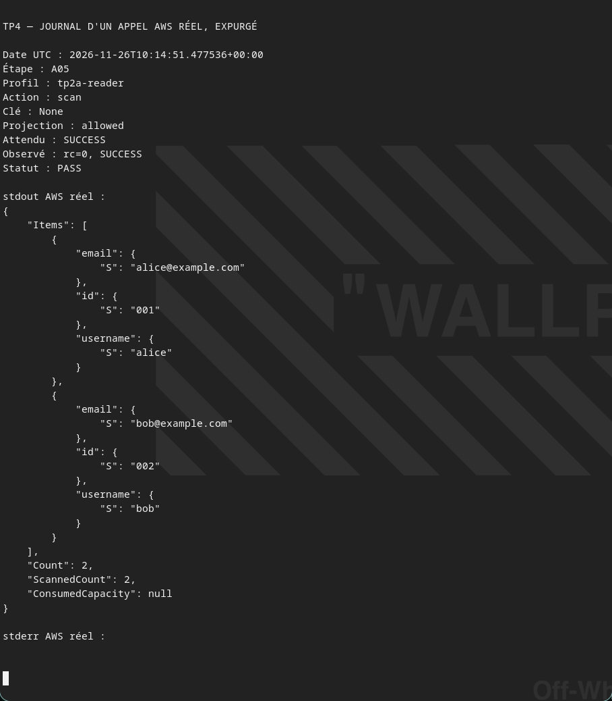 |  |
| 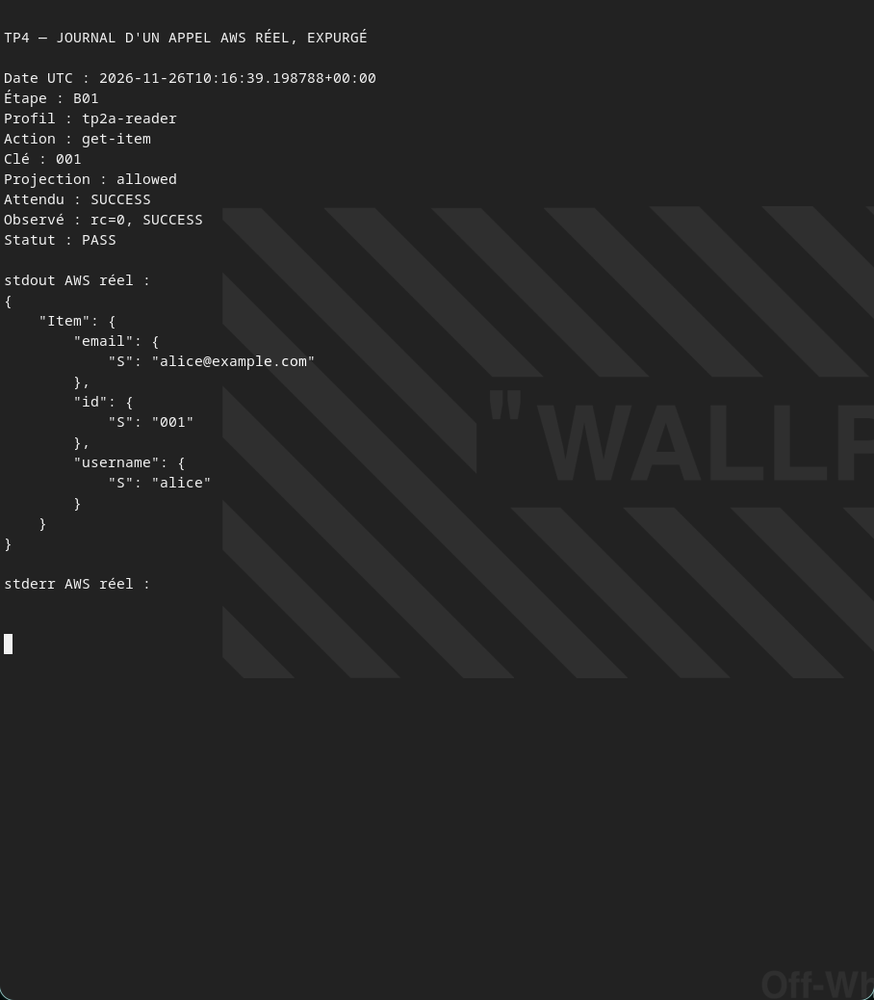 | 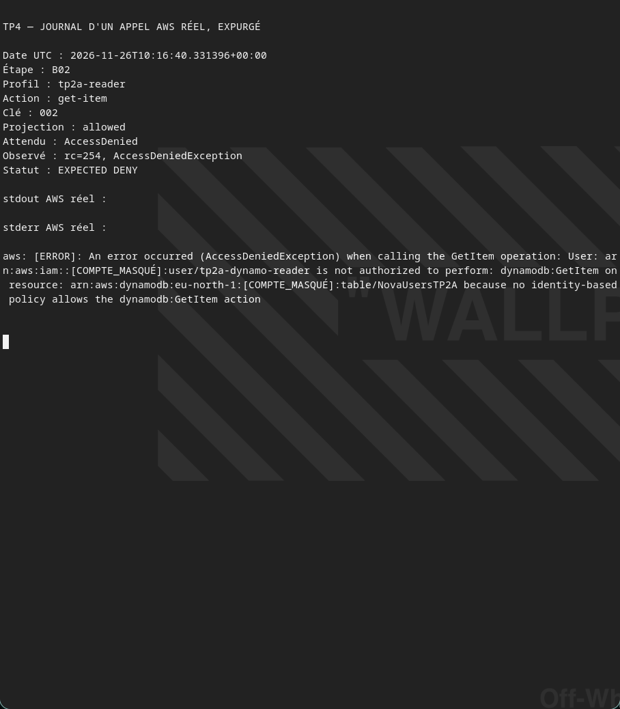 | 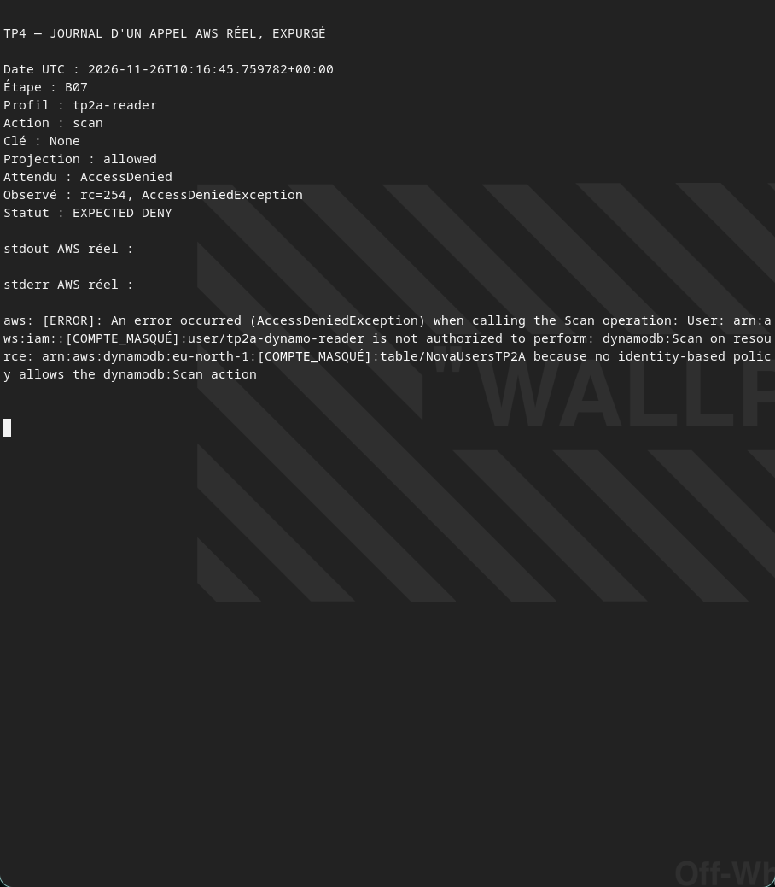 |
| 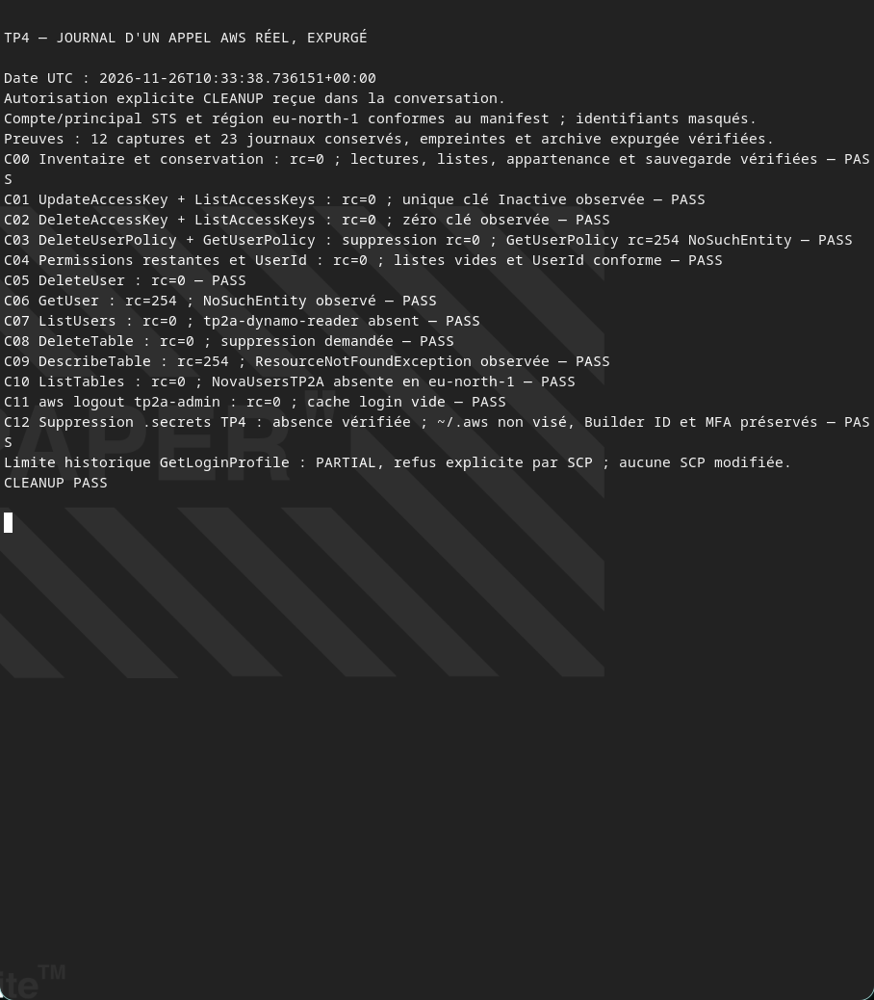 |  |  |

## Source et méthode réellement suivie

Le PDF officiel de dix pages a été lu. La première policy reproduit ses actions et conditions, avec le Sid ReadPublicAttributes. Le PDF demande deux JSON mais ne fournit que le premier ; la seconde policy est la construction complémentaire avec Attributes, LeadingKeys 001, contrôles Null et retrait de Scan.

La table a été créée par l'utilisateur dans la console. L'insertion des items, la création du lecteur et l'application des policies ont ensuite utilisé la CLI, conformément à son autorisation explicite d'automatisation. Ces variantes sont distinguées de la méthode console du PDF dans la provenance. L'unique clé reader a été créée et configurée par l'utilisateur, sans transmission de secrets dans la conversation. Aucune clé administrateur permanente n'a été créée.

Les JSON versionnés dans policies/ sont anonymisés avec REGION et ACCOUNT_ID. Les deux JSON déployables avec l'ARN exact sont exclusivement dans `.secrets/policies/` ; leur ARN a été lié au compte STS vérifié et validé avant application. Le numéro de compte n'est pas publié.

## Environnement isolé

Depuis `/home/gatta/Downloads/TP4`, dans Fish :

```fish
source scripts/use-lab-env.fish
```

Ou, dans Bash :

```bash
source scripts/use-lab-env.sh
```

AWS_CONFIG_FILE, AWS_SHARED_CREDENTIALS_FILE et AWS_LOGIN_CACHE_DIRECTORY désignent `.secrets/`. AWS_PAGER est vide : cette variable attend une commande, pas un dossier. Les scripts enlèvent les credentials et endpoints hérités de l'environnement et vérifient compte, principal, région, TableId, UserId et marqueurs du TP. Profils/manifest : permissions 600 ; répertoires privés : 700. Ne pas activer set -x ou aws --debug.

Paramètres déclarés par l'utilisateur : Blank Canvas, AWS Free plan, eu-north-1, MFA Builder ID TOTP actif. STS a vérifié le compte et les identités hors root ; il ne prouve pas le plan, les crédits, le MFA IAM ou une approbation métier. Après le nettoyage, ne pas sourcer ces scripts : le répertoire privé `.secrets/` a été volontairement supprimé. AWS CLI 2.37.9, Python 3.14.10, Git 2.56.1 ; Fish sur Arch Linux.

## Déroulement réalisé

1. Préflight : absence initiale des ressources et création du manifest privé. La première annonce de table ACTIVE était prématurée ; l'utilisateur a ensuite confirmé que la table n'existait pas encore, puis l'a créée réellement. Le diagnostic historique est conservé.
2. Table NovaUsersTP2A vérifiée ACTIVE : id String, aucune sort key, Standard, On-demand, aucun index, Stream, réplication, PITR, sauvegarde supplémentaire ou resource policy. Tag d'appartenance ajouté à cette seule table et TableId enregistré.
3. Deux items fictifs exacts insérés sans écrasement, puis vérifiés par Scan et GetItem administrateur : 001/alice/alice@example.com/FICTIF-001 et 002/bob/bob@example.com/FICTIF-002, avec internal_note = Demonstration interne ; tous les champs sont String.
4. Lecteur tp2a-dynamo-reader créé sans groupe ni permission ; unique clé créée/configurée manuellement. STS reader exact et clé active unique vérifiés.
5. Refus initial I01 observé avant toute policy : AccessDeniedException, rc=254.
6. Policy Attributes appliquée et relue, propagation IAM attendue : onze tests conformes, dont Scan projeté à deux items et lecture 002 autorisée.
7. Même inline TP2AFGAC remplacée par LeadingKeys, sans permission plus large conservée ; propagation attendue : onze tests conformes. État final : GetItem/Query sur 001 seulement.
8. Contrôle pré-nettoyage sans suppression réussi. Douze captures revues, journaux, matrice, documentation et contrôles locaux conservés.

L'audit IAM confirme l'absence de groupes, managed policies et autre inline policy. GetLoginProfile renvoie un Deny explicite dans une SCP ; son contrôle d'absence reste PARTIAL, sans modification de la SCP ni assimilation à un test DynamoDB. Aucun login console n'a été créé par nos opérations.

## Validation locale

```bash
python3 scripts/validate-policies.py --templates
python3 -m unittest discover -s scripts -p 'test_*.py' -v
python3 scripts/validate-project.py
git diff --check
git status --short
```

Vingt tests unitaires hors ligne réussis (dont deux garde-fous de nettoyage). Le contrôle Markdown utilise markdown-it-py déjà disponible ; l'orchestration AWS utilise la bibliothèque standard Python et AWS CLI. L'audit vérifie les exclusions Git, les motifs sensibles et compare en mémoire les valeurs du fichier credentials aux fichiers suivables, sans jamais les afficher. Les PNG ont été revus visuellement.

Les phases Attributes et LeadingKeys sont des résultats historiques observés avant nettoyage. Les 23 résultats AWS, journaux et captures ont été conservés et empreintés avant les suppressions. Après nettoyage, ne pas sourcer `scripts/use-lab-env.*` : cela recréerait `.secrets/`. Les contrôles locaux post-nettoyage n'accèdent pas à AWS.

## État final après nettoyage

Aucune ressource AWS du TP4 ne reste active : la clé a été désactivée puis supprimée, la policy inline retirée, l'utilisateur absent de GetUser/ListUsers et la table absente de DescribeTable/ListTables. `aws logout` a terminé la session `tp2a-admin`; le cache de connexion est vide. Seul `/home/gatta/Downloads/TP4/.secrets/` a été supprimé ; `~/.aws`, le compte AWS, Builder ID et MFA n'ont pas été visés. Les 12 captures originales et les preuves expurgées ont été préservées avant suppression. GetLoginProfile reste une limite d'audit PARTIAL due au Deny SCP. Aucun push GitHub. Les responsables métier et la date de revue restent À VALIDER.
