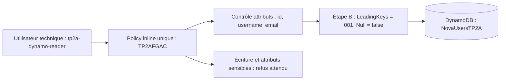

# Architecture et décisions

L'étape A autorise GetItem, Query et Scan avec une projection approuvée sur 001 et 002. L'étape B remplace cette autorisation par GetItem et Query sur 001. Les deux modèles ne doivent pas être attachés simultanément. Le diagramme décrit l'état visé, pas une architecture déjà déployée.

`ForAllValues:StringEquals` borne les attributs demandés ; `Null` exige leur présence. `StringEqualsIfExists` impose SPECIFIC_ATTRIBUTES lorsque Select existe. Pour l'étape B, LeadingKeys est aussi multivalué et sa présence est exigée. Ces choix suivent la [documentation FGAC AWS](https://docs.aws.amazon.com/amazondynamodb/latest/developerguide/specifying-conditions.html).

Un Allow conditionnel n'est pas un Deny explicite : le refus dépend aussi de l'absence d'autre permission applicable. Le lecteur est donc isolé, sans groupe, managed policy, login console ni autre policy inline ; la table ne doit pas porter de resource policy. Les tests AWS vérifient les droits effectivement observés.

Le principal d'administration est temporaire (`aws login`) et distinct de l'identité technique à clé unique imposée dans la demande. Le dossier `.secrets/` contient profils, cache, manifest et policies liées à l'ARN réel. Git conserve les modèles anonymisés et les preuves expurgées. Les tags TP4LabId, TableId et UserId empêchent une adoption silencieuse ou la suppression d'une ressource recréée sous le même nom.

Les opérations concernent seulement la région confirmée eu-north-1 et les noms exacts du laboratoire. Aucun compte root, accès public, AdministratorAccess, changement de plan ou ressource TP3 n'est nécessaire. On-demand est retenu conformément à la demande ; aucune gratuité des opérations n'est affirmée.
